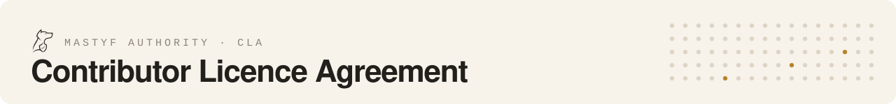

<picture>
  <source media="(prefers-color-scheme: dark)" srcset="assets/header-cla-dark.svg">
  
</picture>

## The short version

| | |
|---|---|
| ✅ **You keep your copyright.** | This is a licence, not a transfer of ownership. |
| 🔁 **Mastyf may license your contribution** | under the AGPL v3 and under commercial terms. That's what keeps the open edition funded. |
| 🛡️ **You promise it's yours to give** | it's your original work, or third-party code is clearly marked with its licence. |
| ✍️ **One comment, once** | the CLA bot asks on your first pull request; you reply with one sentence. |

<b>Read the full agreement</b>

 

Thank you for contributing to a project maintained by **Rudraneel Das, carrying on business as Mastyf (mastyf.ai)**, and on and after its incorporation by **Mastyf Labs Private Limited** (**"Mastyf"**). "Mastyf" includes their successors and assigns. Mastyf may transfer this Agreement without notice to You. This Agreement sets out the terms on which you (**"You"**) make Contributions. By signing, or by clicking "I agree" in the CLA tool, You accept it.

## 1. Definitions

**"Contribution"** means any original work, including code, documentation and other material, together with any modification of an existing work, that You intentionally submit to Mastyf for inclusion in any project or repository owned or managed by Mastyf.

A work is "submitted" if it is sent by any form of electronic, verbal or written communication, including pull requests, patches, issues and discussions. It is not submitted if You conspicuously mark it **"Not a Contribution."**

## 2. Copyright licence

2.1 You grant Mastyf, and recipients of software distributed by Mastyf, a licence to:

(a) reproduce, prepare derivative works of, publicly display, publicly perform, distribute and make available (including as a hosted or network service) Your Contributions and derivative works of them; and

(b) sublicense and **relicense them under any terms, including open-source licences such as the GNU AGPL v3, and commercial, proprietary or dual-licence terms**.

2.2 The licence is perpetual, worldwide, non-exclusive, royalty-free and irrevocable (except as stated in section 3).

2.3 **Territory and duration.** For the purposes of sections 19 and 30A of the Copyright Act, 1957, the licence:

(a) is worldwide;

(b) lasts for the full term of copyright; and

(c) shall not lapse for non-exercise.

## 3. Patent licence

3.1 You grant Mastyf, and recipients of software distributed by Mastyf, a licence to make, have made, use, offer to sell, sell, import and otherwise transfer the work. The licence:

(a) is perpetual, worldwide, non-exclusive, royalty-free and irrevocable (except as stated in clause 3.2); and

(b) covers only patent claims that You can license and that are necessarily infringed by Your Contribution alone, or by its combination with the project to which it was submitted.

3.2 If any entity institutes patent litigation alleging that Your Contribution, or the work it was submitted to, infringes a patent, any patent licence granted to that entity under this Agreement for that work terminates on the date that litigation is filed.

## 4. Your representations

You represent that:

(a) You are legally entitled to grant these licences, and You are at least 18 years old;

(b) each Contribution is Your original creation;

(c) any third-party material in a Contribution is identified, with its licence; and

(d) if Your employer, university or another party has rights to intellectual property that You create, You have permission to make the Contribution on Mastyf's behalf, or Your employer has waived those rights.

## 5. Moral rights

To the extent permitted by law, You agree not to assert moral rights, including under section 57 of the Copyright Act, 1957, against Mastyf or its licensees in respect of modification of Your Contributions, or their use without attribution, in the ordinary course of software development and distribution.

## 6. No warranty, no obligation

6.1 Unless You agree otherwise in writing, You provide Contributions **"as is"**, without warranties of any kind.

6.2 Mastyf is not obliged to use any Contribution.

6.3 You keep all right, title and interest in Your Contributions, except for the licences granted here.

## 7. Notice of changes

You will notify Mastyf if You become aware of any fact that makes the representations in section 4 inaccurate.

## 8. Law

This Agreement is governed by the laws of India. The courts at **Kolkata, West Bengal** have jurisdiction.

---

**How you accept:** on your first pull request, a bot asks you to sign. Reply with exactly: "I have read the CLA Document and I hereby sign the CLA". Your GitHub username, the date and the pull request are recorded in this repository (branch `cla-signatures`). That acceptance is a valid electronic contract under section 10A of the Information Technology Act, 2000.

