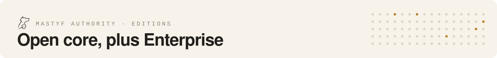
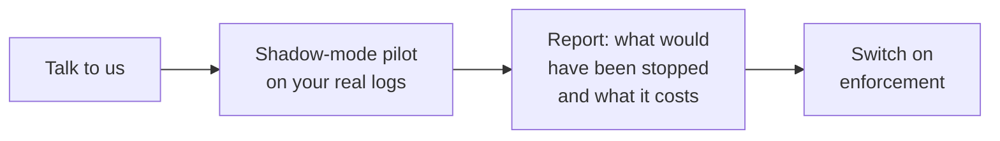

<picture>
  <source media="(prefers-color-scheme: dark)" srcset="assets/header-commercial-dark.svg">
  
</picture>

**The open edition is the whole security system.** Everything that sets the ceiling is open and free under the AGPL v3. **Enterprise adds what larger organisations need to roll it out, run it and prove it.**

## Compare editions

| | Open AGPL v3 · free | Enterprise commercial licence |
|---|:---:|:---:|
| **Protection** | | |
| Decision engine, signed single-use grants | ✅ | ✅ |
| Behavioural risk model: the method and training code (no attack examples needed) | ✅ | ✅ |
| Two-person approval | ✅ | ✅ |
| Key vault with daily budgets (Rust key service) | ✅ | ✅ |
| Device binding with passkeys | ✅ | ✅ |
| Change and undo gates | ✅ | ✅ |
| AI-agent limits | ✅ | ✅ |
| Script integrity check | ✅ | ✅ |
| Tamper-evident audit log | ✅ | ✅ |
| **Detection** | | |
| 🧠 Production risk model, trained and tuned (the open edition trains its own on simulated incidents) | | ✅ |
| 🕵️ Insider-detection pack: the real-data pipeline and settings behind 179 of 187 insiders on CMU CERT | | ✅ |
| **Rollout and operations** | | |
| 🔌 Log connectors: AWS CloudTrail, Okta, GitHub audit logs, more on request | | ✅ |
| 🌗 Shadow-mode pilot: score your real logs for weeks, enforce nothing, get a report | | ✅ |
| 👥 SCIM sync from Okta or Entra ID: teams and leavers automatically; leavers frozen at once | | ✅ |
| 🧬 Leak tracing: every copy that leaves is unique, so a leak points to its source | | ✅ |
| 🛡️ Vendor-side script firewall: catches skimmer campaigns across third-party scripts | | ✅ |
| ☁️ Hosted Authority Cloud: we run the authority and key service | | ✅ |
| **Licence and support** | | |
| Use without AGPL obligations, or embed in your own product | | ✅ |
| Response-time commitments, deployment help, evidence packs for audits | | ✅ |

## How to start

  

<b>Why is it open core and not fully open?</b>

 

Everything you need to **trust** Authority, and to run it yourself, is open: you can read and test every line that sets the ceiling. The paid parts are the ones that save a large organisation time and prove results to its auditors. They pay for the open work.

<b>Do I need a commercial licence?</b>

 

Only if you can't meet the AGPL v3: for example, if you run a modified version as a service and don't want to share your changes, or you embed Authority in a product you sell. Using it inside your own company, unmodified or modified, is free under the AGPL.

