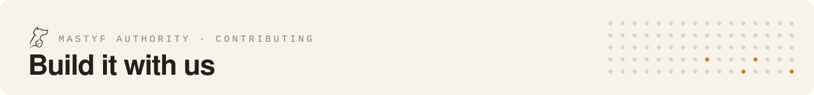
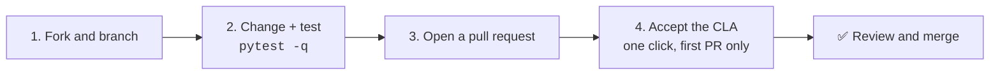

<picture>
  <source media="(prefers-color-scheme: dark)" srcset="assets/header-contributing-dark.svg">
  
</picture>

Thank you for helping. **Bug reports, tests, attacks that break things and clearer docs are all welcome.**

## Your first pull request, in 4 steps



> [!TIP]
> **Why the CLA?** Mastyf offers this code under the AGPL v3 *and* under a commercial licence. The [CLA](CLA.md) gives Mastyf the right to include your contribution in both. **You keep the copyright in your work.**

## Good to know

| ✅ Please | ⛔ Please don't |
|---|---|
| Keep each pull request to one focused change | Report security problems in public issues or PRs. Use [private reporting](SECURITY.md). |
| Add a test for any behaviour you change | Commit datasets, keys, tokens or real logs |
| Run `pytest -q` before you push | Copy in code whose licence doesn't fit the AGPL v3 |
| Name the source of any copied code in your PR | Weaken a guarantee (e.g. let the risk model grant) without a design discussion first |

<details>
<summary><b>Set up a development environment</b></summary>

```bash
python3 -m venv .venv && . .venv/bin/activate
pip install -e '.[dev]'
(cd rust/keyservice && cargo build --release)
pytest -q
```
</details>
