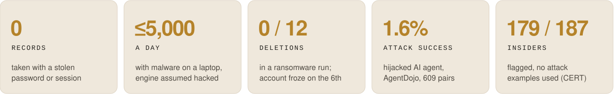
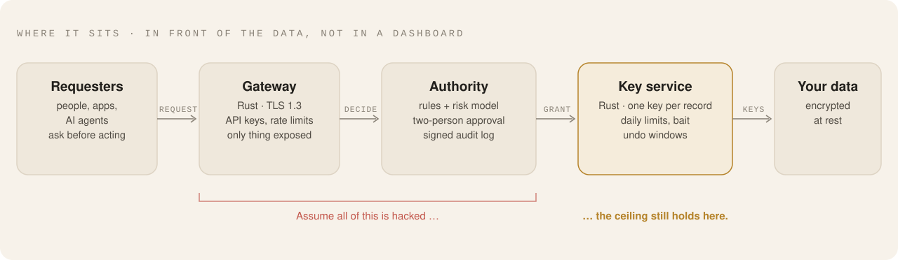
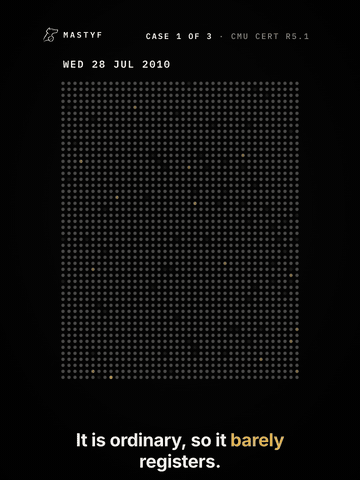

<picture>
  <source media="(prefers-color-scheme: dark)" srcset="assets/banner-dark.svg">
  
</picture>

<p align="center">
  <a href="LICENSE"></a>
  <a href="COMMERCIAL.md"></a>
  
  
  
  <a href="https://github.com/mastyf-ai/mastyf-authority/actions/workflows/tests.yml"></a>
  <a href="https://scorecard.dev/viewer/?uri=github.com/mastyf-ai/mastyf-authority"></a>
  <a href="SECURITY.md"></a>
</p>

<p align="center">
  <a href="https://www.mastyf.ai/authority"><b>Try the interactive demo</b></a> ·
  <a href="#quick-start"><b>Run it in 2 minutes</b></a> ·
  <a href="SECURITY.md"><b>Break it</b></a> ·
  <a href="COMMERCIAL.md"><b>Enterprise</b></a>
</p>

---

Most security tries to spot attackers. **Authority assumes some will get in, and makes the most they can do a small number that is known in advance.** That number is:
- **computed beforehand**, from your policy;
- **enforced where the data and irreversible actions live**, not in a dashboard; and
- **tested by attacking it**, in public.

<picture>
  <source media="(prefers-color-scheme: dark)" srcset="assets/stats-dark.svg">
  
</picture>

> [!NOTE]
> **Research preview (v0.1).** These results come from simulations and public datasets, not yet from a customer's production systems. [What the numbers do and don't mean ↓](#read-the-results-with-care)

## Start here

| I'm a… | Start with | Time |
|---|---|---|
| 🛡️ **Security lead** | [Free Damage Ceiling Report](https://www.mastyf.ai/authority#report): the most a stolen login can take from your company, from 30 days of read-only logs · [Pricing](https://www.mastyf.ai/authority#pricing) | 48 h |
| 🧑‍💻 **Engineer** | [Quick start](#quick-start): install, train a model, replay real incidents | 2 min |
| 🕵️ **Security researcher** | [Break it](#break-it): a fake company on the real components, with flags and safe harbour | 10 min |
| 🤝 **Contributor** | [CONTRIBUTING.md](CONTRIBUTING.md): one focused change, one test, one CLA comment | — |

## How it decides

Every high-impact action is checked **before** it runs: bulk reads of secrets, data exports, script and package publishes, Git history rewrites, backup deletions, mass writes and AI-agent tool calls. Rules go first, and a behavioural model comes last. **The model can escalate or deny. It can never grant.**

<picture>
  <source media="(prefers-color-scheme: dark)" srcset="assets/decide-dark.svg">
  
</picture>

<picture>
  <source media="(prefers-color-scheme: dark)" srcset="assets/architecture-dark.svg">
  
</picture>


## How the model thinks, in dots and flashes



Each dot is one person in a company of 2,000. For every person and every kind of action, the model asks three plain questions:

| | Question | Adds weight when |
|---|---|---|
| **01** | Done this before? | This person has never done it |
| **02** | How many people here do it? | Few people do |
| **03** | More than ever before? | They beat their own record, for things fewer than 1 in 5 people do |

It learns from each company's own history and uses **no attack examples**. Each morning a reviewer sees the five strangest person-days.

▶ **[Watch the 3-minute film with chapters](https://www.mastyf.ai/authority#thinking)**: three real cases, one of which the model misses, and what stops it anyway.

<br clear="right">

## What's inside

| | Layer | What it guarantees | |
|---|---|---|---|
| 🧭 | **Decision engine**: `engine.py` `policy.py` | Rules plus the risk model; Ed25519-signed, single-use grants bound to the exact action | Open |
| 👥 | **Two-person approval**: `quorum.py` `approver.py` | Unusual actions need a second person, who cannot be the requester | Open |
| 🔐 | **Key vault with budgets**: `budgets.py` `bounded.py` `rust/keyservice` | One key per record; daily limits per person, data class and destination, enforced even if everything in front is hacked | Open |
| 📱 | **Device binding**: `binding.py` `webauthn.py` | Keys only reach the person's own registered device; a stolen password, cookie or token opens nothing | Open |
| ⏳ | **Change and undo gates**: `gates.py` `undo.py` | History rewrites need two people; irreversible actions wait out an undo window | Open |
| 🤖 | **AI-agent limits**: `agents.py` | Agents perform only the task a person approved: named actions, recipients and record caps | Open |
| 🧩 | **Script integrity**: `script_integrity.py` | Blocks a changed script that adds new destinations or skimmer patterns | Open |
| 🧾 | **Tamper-evident audit**: `audit.py` | Hash-chained, signed log of every decision | Open |
| ✨ | **Leak tracing, log connectors, shadow-mode pilots, SCIM sync, script firewall, hosted cloud** | Rollout, operations and proof for larger organisations | [Enterprise →](COMMERCIAL.md) |

## Quick start

```bash
git clone https://github.com/mastyf-ai/mastyf-authority && cd mastyf-authority
python3 -m venv .venv && . .venv/bin/activate
pip install -e '.[dev]'

authority train --out artifacts                    # train your own risk model on simulated incidents
authority replay                                   # run the incidents end to end through the authority
authority ceiling --policy policies/default.json   # the worst-case damage of a compromise, from your policy
```

<details>
<summary><b>Build the Rust key service and run every test</b></summary>

```bash
(cd rust/keyservice && cargo build --release)   # mastyf-keyservice and mastyf-gateway
pytest -q                                       # Python and Rust tests, including fuzzing
```

To deploy, use `deploy/`: the Dockerfiles, a Caddy TLS proxy and the systemd units. Run the authority behind TLS only, and keep the key service on a separate host.
</details>

<details>
<summary><b>About the insider-detection result (CMU CERT)</b></summary>

The scoring method is in this repository (`novelty.py`, `model.py`). Train your own model on the simulated incidents with `authority train --out artifacts`.

**Enterprise only:**
- the production model;
- the real-data insider-detection pipeline (CERT and LANL);
- the tuned settings behind the 179 of 187 result.

The method was chosen on releases r4–r5 and then run unchanged on r2 and r6, where it caught 9 of 11 insiders. Researchers who want to verify the result can ask us for access under NDA through [mastyf.ai/pilot](https://www.mastyf.ai/pilot).
</details>

<details id="read-the-results-with-care">
<summary><b>Read the results with care</b></summary>

- **Synthetic data:** CMU's CERT insider data is computer-generated, not logs from a real company.
- **Simulated incidents:** the incident simulations are built from news descriptions. Real traffic is messier.
- **Rules do much of the work:** much of the stopping is done by deterministic rules. The fair test of the model is the held-out result.
- **Not covered:** bugs in your own apps, browsers or OS; delivery of inbound phishing; DDoS; USB copying on the endpoint; people misusing what they may legitimately see. The ceiling limits these, and leak tracing (Enterprise) traces them.
</details>

## Break it

> [!IMPORTANT]
> **The sandbox is open: run it on your own machine.** It runs a fake company, Acme, on the real components, with real limits and hidden bait. You play a stolen account. Each finding gets credit in the hall of fame.

```bash
cd sandbox && docker compose up -d --build && python3 example_attack.py
```

Flags are counted automatically, and **[`sandbox/verify.sh`](sandbox/README.md)** re-runs your attack against a fresh sandbox, exactly as we verify reports. **[Sandbox guide →](sandbox/README.md)**

| 🎯 Target | You win if you… |
|---|---|
| **The ceiling** | take more than the published limit for any account or group of accounts |
| **The undo window** | make an irreversible action happen before its undo window ends |
| **AI-agent limits** | make a hijacked agent act outside its approved task |
| **The vault** | read record keys, the vault's state or another tenant's data |
| **The model** | make the risk model **grant** anything |

Rules and safe harbour are in **[SECURITY.md](SECURITY.md)**. Report privately with the **"Report a vulnerability"** button, never in public issues.

## License, in plain words

| If you… | Then |
|---|---|
| use, study or change Authority for yourself or your company | ✅ Free under the [AGPL v3](LICENSE) |
| run a **modified** version as a service other people use | Share your changes with those users, under the AGPL v3 |
| can't accept AGPL terms, or want to embed Authority in a product you sell | Get a [commercial licence](COMMERCIAL.md) · [see pricing](https://www.mastyf.ai/authority#pricing) |
| want to contribute | 💛 Welcome. Sign the [CLA](CLA.md) with one comment; you keep your copyright ([how to contribute](CONTRIBUTING.md)) |

<sub>Copyright © 2026 Rudraneel Das (Mastyf). "Mastyf" and "Mastyf Authority" are trade marks of Mastyf; the licence does not grant rights to use them. The `LICENSE` file is the official, unmodified AGPL v3 text.</sub>
