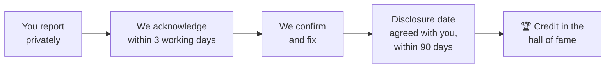

<picture>
  <source media="(prefers-color-scheme: dark)" srcset="assets/header-security-dark.svg">
  
</picture>

We want you to attack Authority. This page explains **what to aim at**, **how to report** and **how you're protected**.

## 1 · Report privately

> [!IMPORTANT]
> Use GitHub's **"Report a vulnerability"** button on this repository's **Security** tab. **Never** report in a public issue or pull request.

## 2 · What counts as a win

| | You win if you… |
|---|---|
| 🎯 | **Take more than the ceiling**: more data than the published limit for any account or set of accounts |
| ⏳ | **Beat the undo window**: an irreversible action runs before its window ends, or without the required approvals |
| 🤖 | **Escape the agent limits**: a hijacked AI agent completes an action outside its approved task |
| 🔐 | **Open the vault**: read record keys, the vault's state, or another tenant's data |
| 🧾 | **Forge or replay**: a grant, an approval or an audit-log entry |
| 🧠 | **Make the model grant**: the risk model may only ever escalate or deny. Any path where it allows something is a finding. |

## 3 · Scope

| ✅ In scope | ⛔ Out of scope |
|---|---|
| The code in this repository | The mastyf.ai website and production systems |
| The [break-it sandbox](sandbox/README.md), run on your own machine. Attacks must work through its two endpoints and pass `sandbox/verify.sh`. Everything in it is fake. | Reading the sandbox's own volumes or containers on your machine (you own that machine) |
| The "authority bypassed" worst cases the design claims to bound | Denial of service, flooding, load testing |
| | Social engineering of Mastyf staff, physical attacks |
| | Attacks that need a modified server or a compromised operator machine (apart from the claimed worst cases) |

## 4 · Safe harbour

<b>In short: good-faith research within scope is authorised, and we won't pursue you.</b>

 

This section is adapted from the [disclose.io](https://github.com/disclose/dioterms) safe-harbour terms. If you make a good-faith effort to follow this policy, we consider your research **authorised**. Specifically:

- **No legal action:** we will not initiate or support legal action against you, including under India's Information Technology Act, 2000 or anti-circumvention laws, for activity within scope.
- **Third parties:** if a third party takes legal action over activity that followed this policy, we will make it known that your activity was authorised.

**Your side of the deal:**
- Stay within scope.
- Stop and report as soon as you reach data that isn't yours.
- Keep or share only what you need to show the issue.
- Give us a reasonable time to fix it before you publish.

Not sure whether something is in scope? Ask in a private report first.

## 🏆 Hall of fame

*Empty for now. Your name could be first.*

## 5 · Who has checked this code

Every check below runs in public: results are in this repository's **Actions** tab, and every release carries its
own evidence.

| Check | What it looks at | When |
|---|---|---|
| **CodeQL** (GitHub) | Code flaws in Python, Rust, the console's JavaScript and the CI workflows | Every change |
| **Semgrep** security rules | Python, Rust and JavaScript patterns (fails on any ERROR finding) | Every change, weekly |
| **pip-audit**, **OSV-Scanner** | Known vulnerabilities in Python and Rust dependencies | Every change, weekly |
| **OWASP ZAP** baseline scan | The web console, attacked from outside while running (fails on any new alert) | Every change, weekly |
| **Fuzzing** (cargo-fuzz + property tests) | The key service's parsers and budget logic | Every change |
| **TLA+ model check** | The failover protocol (`formal/Failover.tla`; it found three bugs, all fixed) | By hand, when failover changes |
| **Trivy** | Every release image (no fixable HIGH or CRITICAL issue may ship) | Every release |
| **OpenSSF Scorecard** | The project's security practices | Weekly |
| **Signed releases** | Sigstore signatures, SLSA build provenance and an SBOM for every image and package | Every release |

**Not yet:** a manual audit by an independent firm. We have asked the Open Source Technology Improvement Fund
(OSTIF) for one; until it is done, treat Authority as unaudited and start in shadow mode. When the report exists it
will be linked here, in full, with every finding and its fix.
