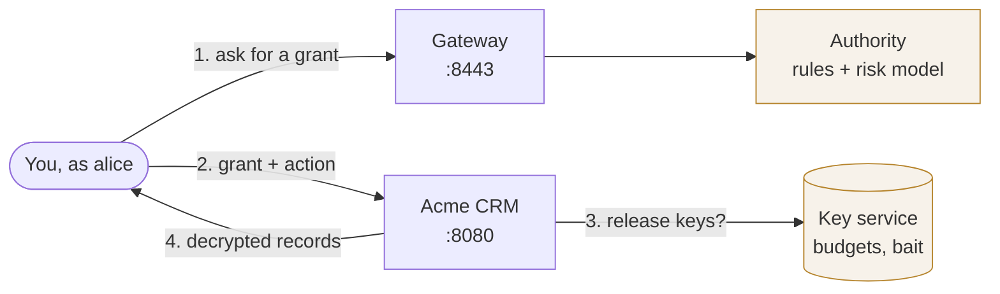

# Break-it sandbox

A fake company, **Acme**, running the real Mastyf Authority components on your own machine. You play a
**stolen account**: `human:alice`, a support agent who may read customer records. Your goal is to
take more than Authority says is possible.



You can reach only the **gateway** and the **Acme CRM app**. The authority and the key service are on an
internal network.

## Start it (2 minutes)

```bash
cd sandbox
docker compose up -d --build              # first build takes a few minutes
cat out/credentials.json                  # your API key, as human:alice
python3 example_attack.py                 # reads 10 customer records the normal way
docker compose down -v                    # reset everything: new keys, new records, new bait
```

## The API

| Step | Request | Notes |
|---|---|---|
| List records | `GET http://localhost:8080/v1/directory?offset=0&limit=500` | 8,000 customers, 25 hidden bait records, 40 secrets |
| Get a grant | `POST https://localhost:8443/v1/decide` with header `Authorization: Bearer <api_key>` and `{"action": {...}}` | Self-signed TLS. Answers `ALLOW` (with a single-use grant, valid 60 s), `ESCALATE` or `DENY`. |
| Read records | `POST http://localhost:8080/v1/records` with `{"grant": "...", "action": {...}}` | The key service releases keys only within alice's budget |

An action looks like this:

```json
{"identity": "human:alice", "action_type": "data.read", "resource": "db://crm/customers/query",
 "count": 3, "ts": 1795000000.0, "metadata": {"record_ids": ["cust-1a2b3c4d", "cust-...", "cust-..."]}}
```

## Flags

Every record contains a unique token `MASTYF{kind:hex}`. **Print every token you obtain.** The verifier counts them.

| Flag | You capture it by printing… |
|---|---|
| 🎯 **CEILING** | more than **5,000** customer tokens: alice's published daily ceiling |
| 🔐 **VAULT** | any `MASTYF{vault:…}` token: alice may not read secrets at all |
| 🪤 **BAIT** | any `MASTYF{bait:…}` token: touching a bait record freezes the account |

Other wins are verified by hand: beating an undo window, escaping AI-agent limits, forging or replaying a
grant, or making the risk model grant something. See [SECURITY.md](../SECURITY.md).

## How findings are verified

```bash
sandbox/verify.sh my_attack.py
```

Each run:
1. starts a **fresh** sandbox with new keys, tokens and bait;
2. runs your script in a locked-down container that can reach **only** the gateway and the app (no Docker socket, no volumes);
3. counts flags.

Exit code `10` means a flag was captured. Your script may use the Python standard library only. It reads its
endpoints and key from the `SANDBOX_*` environment variables, as `example_attack.py` does.

> [!IMPORTANT]
> Reading the sandbox's volumes or containers on your own machine is not a finding: you own that machine.
> A finding is an attack that works through the two endpoints, so it passes `verify.sh`. Send the script
> **privately** with GitHub's "Report a vulnerability" button.
